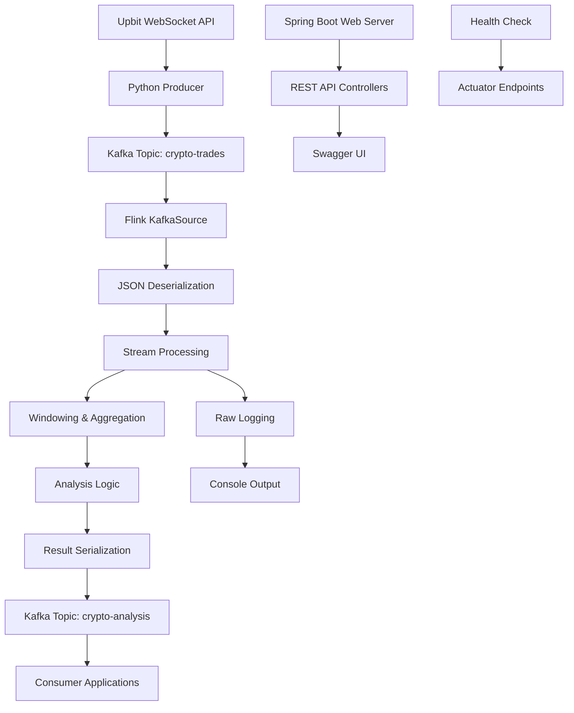

# 🔧 Crypto Tracker 기술 구현 가이드

## 📋 목차

- [시스템 아키텍처 개요](#시스템-아키텍처-개요)
- [데이터 수집 구현](#데이터-수집-구현)
- [Kafka 연동 구현](#kafka-연동-구현)
- [Flink 스트리밍 처리](#flink-스트리밍-처리)
- [데이터 집계 및 윈도우 처리](#데이터-집계-및-윈도우-처리)
- [분석 알고리즘 구현](#분석-알고리즘-구현)
- [성능 최적화](#성능-최적화)

## 🏗 시스템 아키텍처 개요

### 전체 데이터 플로우



### 핵심 컴포넌트

1. **데이터 수집 계층**: Python WebSocket Producer
2. **메시지 큐 계층**: Apache Kafka
3. **스트리밍 처리 계층**: Apache Flink
4. **애플리케이션 계층**: Spring Boot + REST API
5. **API 문서화**: Swagger UI + OpenAPI 3.0
6. **모니터링**: Spring Boot Actuator

## 📊 데이터 수집 구현

### 1. Upbit WebSocket 연결

```python
# scripts/producer.py
import asyncio
import json
import websockets
from kafka import KafkaProducer

# WebSocket 연결 설정
uri = "wss://api.upbit.com/websocket/v1"
subscribe_fmt = [
    {"ticket": str(uuid.uuid4())},
    {
        "type": "ticker",
        "codes": ["KRW-BTC"]
    }
]
```

**기술적 특징:**

- **비동기 WebSocket**: `asyncio`와 `websockets` 라이브러리 사용
- **실시간 스트리밍**: 업비트 공식 WebSocket API 활용
- **자동 재연결**: 연결 실패 시 REST API 폴백 메커니즘

### 2. 데이터 수집 로직

```python
async def connect_and_produce():
    async with websockets.connect(uri, ssl=False) as websocket:
        # 구독 메시지 전송
        await websocket.send(json.dumps(subscribe_fmt))

        while True:
            # 실시간 데이터 수신
            data_str = await websocket.recv()
            data = json.loads(data_str)

            # Kafka로 즉시 전송
            producer.send('crypto-trades', value=data)
```

**수집되는 데이터 구조:**

```json
{
  "type": "ticker",
  "code": "KRW-BTC",
  "trade_price": 151183000.0,
  "trade_volume": 0.00013228,
  "timestamp": 1756712240103,
  "change": "RISE",
  "change_rate": 0.0032050431,
  "acc_trade_price": 162174950479.25195,
  "acc_trade_volume": 1081.98564585
}
```

### 3. 장애 처리 및 폴백

```python
async def fallback_to_rest_api():
    async with aiohttp.ClientSession() as session:
        while True:
            url = "https://api.upbit.com/v1/ticker?markets=KRW-BTC"
            async with session.get(url) as response:
                data = await response.json()

                # WebSocket 형식으로 데이터 변환
                realtime_data = {
                    "type": "ticker",
                    "code": ticker_data.get("market"),
                    "trade_price": ticker_data.get("trade_price"),
                    # ... 기타 필드 매핑
                }

            await asyncio.sleep(1)  # 1초 간격 폴링
```

## 🔗 Kafka 연동 구현

### 1. Kafka Producer 설정

```python
# Python Producer 설정
producer = KafkaProducer(
    bootstrap_servers='localhost:9092',
    value_serializer=lambda v: json.dumps(v).encode('utf-8')
)
```

### 2. Flink Kafka 커넥터 설정

```java
// FlinkJobConfig.java
@Bean
public KafkaSource<String> kafkaSource() {
    return KafkaSource.<String>builder()
            .setBootstrapServers(bootstrapServers)
            .setTopics(inputTopic)  // "crypto-trades"
            .setGroupId(groupId)    // "crypto-flink-group"
            .setValueOnlyDeserializer(new SimpleStringSchema())
            .build();
}

@Bean
public KafkaSink<String> kafkaSink() {
    return KafkaSink.<String>builder()
            .setBootstrapServers(bootstrapServers)
            .setRecordSerializer(KafkaRecordSerializationSchema.builder()
                    .setTopic(outputTopic)  // "crypto-analysis"
                    .setValueSerializationSchema(new SimpleStringSchema())
                    .build())
            .build();
}
```

## 🌊 Flink 스트리밍 처리

### 1. 스트림 환경 설정

```java
// FlinkJobConfig.java
@Bean
public StreamExecutionEnvironment streamExecutionEnvironment() {
    StreamExecutionEnvironment env = StreamExecutionEnvironment.getExecutionEnvironment();

    // 체크포인트 설정
    env.enableCheckpointing(10000); // 10초마다
    CheckpointConfig checkpointConfig = env.getCheckpointConfig();
    checkpointConfig.setCheckpointTimeout(60000);
    checkpointConfig.setMinPauseBetweenCheckpoints(5000);
    checkpointConfig.setMaxConcurrentCheckpoints(1);

    // 병렬성 설정
    env.setParallelism(1);

    return env;
}
```

### 2. 원본 로그 스트리밍

```java
// RawLogStreamingService.java
@PostConstruct
public void startRawLoggerJob() {
    DataStream<String> inputStream = env.fromSource(
            kafkaSource,
            WatermarkStrategy.noWatermarks(),
            "Kafka Source - Raw Logger");

    // 원본 데이터 로깅
    inputStream
            .map(value -> {
                logger.info("📥 RAW: {}", value);
                return value;
            })
            .name("Raw Logger");

    env.execute("Raw Logger Job");
}
```

### 3. JSON 역직렬화

```java
// JsonToCryptoTradeMapper
public static class JsonToCryptoTradeMapper implements MapFunction<String, CryptoTrade> {
    private static final ObjectMapper objectMapper = new ObjectMapper();

    @Override
    public CryptoTrade map(String json) throws Exception {
        try {
            return objectMapper.readValue(json, CryptoTrade.class);
        } catch (Exception e) {
            logger.error("JSON 파싱 오류: " + json, e);
            return null;
        }
    }
}
```

## 📊 데이터 집계 및 윈도우 처리

### 1. 체결강도 집계 (Trade Intensity)

#### 슬라이딩 윈도우 설정

```java
// TradeIntensityService.java
DataStream<TradeIntensity> intensityStream = tradeStream
        .keyBy(CryptoTrade::getCode)  // 암호화폐 코드별 파티셔닝
        .window(SlidingProcessingTimeWindows.of(
                Time.seconds(windowSizeSeconds),    // 윈도우 크기: 60초
                Time.seconds(windowSlideSeconds)))  // 슬라이드: 5초
        .aggregate(new TradeVolumeAggregator())
        .name("Trade Volume Aggregation");
```

#### 거래량 집계 로직

```java
public static class TradeVolumeAggregator
        implements AggregateFunction<CryptoTrade, Tuple3<Double, Double, Integer>, TradeIntensity> {

    @Override
    public Tuple3<Double, Double, Integer> createAccumulator() {
        return new Tuple3<>(0.0, 0.0, 0);  // 매수량, 매도량, 건수
    }

    @Override
    public Tuple3<Double, Double, Integer> add(CryptoTrade trade,
            Tuple3<Double, Double, Integer> accumulator) {

        Double buyVolume = accumulator.f0;
        Double sellVolume = accumulator.f1;
        Integer count = accumulator.f2;

        // 매수/매도 구분
        if ("RISE".equals(trade.getChange())) {
            buyVolume += trade.getTradeVolume();
        } else if ("FALL".equals(trade.getChange())) {
            sellVolume += trade.getTradeVolume();
        }

        return new Tuple3<>(buyVolume, sellVolume, count + 1);
    }

    @Override
    public TradeIntensity getResult(Tuple3<Double, Double, Integer> accumulator) {
        Double buyVolume = accumulator.f0;
        Double sellVolume = accumulator.f1;
        Double totalVolume = buyVolume + sellVolume;

        // 체결강도 계산: (매수량 / 매도량) * 100
        Double intensityScore = 100.0;
        if (sellVolume > 0) {
            intensityScore = (buyVolume / sellVolume) * 100;
        }

        return new TradeIntensity(
                LocalDateTime.now().format(DateTimeFormatter.ISO_LOCAL_DATE_TIME),
                "KRW-BTC",  // 코드 정보는 윈도우 컨텍스트에서 가져와야 함
                windowStart,
                windowEnd,
                windowSizeSeconds,
                buyVolume,
                sellVolume,
                totalVolume,
                intensityScore,
                // ... 기타 필드
        );
    }
}
```

### 2. 고래 감지 집계 (Whale Detection)

#### 더 짧은 윈도우로 민감한 감지

```java
// WhaleDetectionService.java
DataStream<WhaleMovement> whaleMovementStream = tradeStream
        .keyBy(CryptoTrade::getCode)
        .window(SlidingProcessingTimeWindows.of(
                Time.seconds(5),    // 5초 윈도우
                Time.seconds(1)))   // 1초마다 슬라이드
        .aggregate(new WhaleVolumeAggregator())
        .name("Whale Volume Aggregation");
```

#### 고래 감지 로직

```java
public static class WhaleVolumeAggregator
        implements AggregateFunction<CryptoTrade, Tuple3<Double, Double, Integer>, WhaleMovement> {

    @Override
    public WhaleMovement getResult(Tuple3<Double, Double, Integer> accumulator) {
        Double buyVolume = accumulator.f0;
        Double sellVolume = accumulator.f1;
        Double netVolume = buyVolume - sellVolume;  // 순거래량
        Double volumeRatio = sellVolume > 0 ? buyVolume / sellVolume : 0.0;

        return new WhaleMovement(
                LocalDateTime.now().format(DateTimeFormatter.ISO_LOCAL_DATE_TIME),
                "KRW-BTC",
                windowStart,
                windowEnd,
                5,  // 윈도우 크기
                buyVolume,
                sellVolume,
                netVolume,
                volumeRatio,
                0.5,  // 임계치
                false,  // 분석 단계에서 결정
                "NORMAL",
                0.0,
                "NO_PATTERN",
                "LOW"
        );
    }
}
```

## 🧮 분석 알고리즘 구현

### 1. 체결강도 분석

```java
// IntensityAnalyzer
public static class IntensityAnalyzer extends RichMapFunction<TradeIntensity, TradeIntensity> {

    @Override
    public TradeIntensity map(TradeIntensity intensity) throws Exception {

        // 시장 심리 분석
        String marketSentiment = determineMarketSentiment(intensity.getIntensityScore());
        String intensityLevel = determineIntensityLevel(intensity.getIntensityScore());
        String trendDirection = determineTrendDirection(intensity);
        Double trendStrength = calculateTrendStrength(intensity);

        // 알림 생성
        String alertLevel = determineAlertLevel(intensity);
        String alertMessage = generateAlertMessage(intensity, marketSentiment);
        Boolean isAlertTriggered = shouldTriggerAlert(intensity);

        // 결과 업데이트
        intensity.setMarketSentiment(marketSentiment);
        intensity.setIntensityLevel(intensityLevel);
        intensity.setTrendDirection(trendDirection);
        intensity.setTrendStrength(trendStrength);
        intensity.setAlertLevel(alertLevel);
        intensity.setAlertMessage(alertMessage);
        intensity.setIsAlertTriggered(isAlertTriggered);

        // 로깅
        if (isAlertTriggered) {
            logger.info("🚨 체결강도 알림: {} - 강도: {:.2f} - 심리: {} - 알림: {}",
                    intensity.getCode(), intensity.getIntensityScore(),
                    marketSentiment, alertLevel);
        }

        return intensity;
    }

    private String determineMarketSentiment(Double intensityScore) {
        if (intensityScore >= 120) return "BULLISH";
        if (intensityScore <= 80) return "BEARISH";
        return "NEUTRAL";
    }

    private String determineIntensityLevel(Double intensityScore) {
        if (intensityScore >= 150) return "VERY_HIGH";
        if (intensityScore >= 120) return "HIGH";
        if (intensityScore >= 90) return "MEDIUM";
        if (intensityScore >= 60) return "LOW";
        return "VERY_LOW";
    }
}
```

### 2. 고래 움직임 분석

```java
// WhaleMovementAnalyzer
public static class WhaleMovementAnalyzer extends RichMapFunction<WhaleMovement, WhaleMovement> {

    @Override
    public WhaleMovement map(WhaleMovement movement) throws Exception {

        Double netVolume = Math.abs(movement.getNetVolume());

        // 임계치 기반 고래 움직임 판단
        boolean isWhaleMovement = netVolume > 0.5; // 0.5 BTC 이상

        // 움직임 유형 결정
        String movementType = determineMovementType(movement);
        Double confidenceScore = calculateConfidenceScore(movement);
        String patternDetected = detectPattern(movement);
        String alertLevel = determineAlertLevel(movement, isWhaleMovement);

        // 결과 업데이트
        movement.setIsWhaleMovement(isWhaleMovement);
        movement.setMovementType(movementType);
        movement.setConfidenceScore(confidenceScore);
        movement.setPatternDetected(patternDetected);
        movement.setAlertLevel(alertLevel);

        // 고래 움직임 감지 시 로깅
        if (isWhaleMovement) {
            logger.info("🐋 고래 움직임 감지: {} - {} - 순거래량: {} BTC - 알림레벨: {}",
                    movement.getCode(), movementType,
                    String.format("%.4f", netVolume), alertLevel);
        }

        return movement;
    }

    private String determineMovementType(WhaleMovement movement) {
        Double netVolume = movement.getNetVolume();

        if (Math.abs(netVolume) < 0.1) return "BALANCED";
        if (netVolume > 0.5) return "AGGRESSIVE_BUY";
        if (netVolume < -0.5) return "AGGRESSIVE_SELL";
        return "NORMAL";
    }

    private String detectPattern(WhaleMovement movement) {
        Double netVolume = movement.getNetVolume();
        Double totalVolume = movement.getTotalBuyVolume() + movement.getTotalSellVolume();

        if (totalVolume > 2.0 && Math.abs(netVolume) > 1.0) {
            return "MASSIVE_MOVEMENT";
        } else if (totalVolume > 1.0 && Math.abs(netVolume) > 0.5) {
            return "SIGNIFICANT_MOVEMENT";
        } else if (Math.abs(netVolume) > 0.3) {
            return "MODERATE_MOVEMENT";
        }
        return "NO_PATTERN";
    }
}
```

## 🌐 Spring Boot 웹 서버 및 API 구현

### 1. 웹 서버 아키텍처

```java
// CryptoFlinkApplication.java
@SpringBootApplication
@EnableScheduling
public class CryptoFlinkApplication {
    public static void main(String[] args) {
        SpringApplication.run(CryptoFlinkApplication.class, args);
    }
}
```

**핵심 특징:**

- **포트 8082**: 기본 웹 서버 포트
- **Actuator**: 헬스 체크 및 모니터링 엔드포인트
- **Swagger UI**: API 문서화 및 테스트 인터페이스

### 2. 비동기 Flink Job 실행

**문제**: Flink Job의 `env.execute()`가 Spring Boot 메인 스레드를 블로킹
**해결**: `CompletableFuture.runAsync()`를 사용하여 별도 스레드에서 실행

```java
// RawLogStreamingService.java
@PostConstruct
public void initRawLoggerJob() {
    // 별도 스레드에서 Flink Job 시작
    CompletableFuture.runAsync(() -> startRawLoggerJob());
}

public void startRawLoggerJob() {
    try {
        // ... Flink Job 로직
        env.execute("Raw Logger Job");
    } catch (Exception e) {
        logger.error("❌ Raw Logger Job 실행 중 오류 발생: ", e);
    }
}
```

### 3. Swagger UI 설정

```java
// SwaggerConfig.java
@Configuration
public class SwaggerConfig {

    @Bean
    public OpenAPI openAPI() {
        return new OpenAPI()
                .info(new Info()
                        .title("🚀 Crypto Tracker API")
                        .description("실시간 암호화폐 분석 플랫폼 API")
                        .version("1.0.0")
                        .contact(new Contact()
                                .name("Crypto Tracker Team")
                                .email("dev@cryptotracker.com"))
                        .license(new License()
                                .name("MIT License")
                                .url("https://opensource.org/licenses/MIT")))
                .servers(List.of(
                        new Server().url("http://localhost:8082").description("Local Development Server")
                ));
    }
}
```

**접속 URL**: `http://localhost:8082/swagger-ui/index.html`

### 4. REST API 컨트롤러

#### 4-1. 체결강도 분석 API

```java
// TradeIntensityController.java
@RestController
@RequestMapping("/api/trade-intensity")
@Tag(name = "Trade Intensity", description = "실시간 체결강도 분석 API")
public class TradeIntensityController {

    @GetMapping("/health")
    @Operation(summary = "서비스 상태 확인", description = "체결강도 분석 서비스의 상태를 확인합니다")
    @ApiResponses(value = {
            @ApiResponse(responseCode = "200", description = "서비스 정상"),
            @ApiResponse(responseCode = "503", description = "서비스 비정상")
    })
    public ResponseEntity<Map<String, Object>> getHealth() {
        Map<String, Object> response = new HashMap<>();
        response.put("status", "UP");
        response.put("service", "Trade Intensity Analysis");
        response.put("timestamp", LocalDateTime.now());
        return ResponseEntity.ok(response);
    }

    @GetMapping("/recent")
    @Operation(summary = "최근 체결강도 조회", description = "최근 분석된 체결강도 데이터를 조회합니다")
    public ResponseEntity<List<TradeIntensity>> getRecentIntensity(
            @RequestParam(defaultValue = "10") int limit) {
        // 구현 예정
        return ResponseEntity.ok(new ArrayList<>());
    }
}
```

#### 4-2. 고래 감지 API

```java
// WhaleDetectionController.java
@RestController
@RequestMapping("/api/whale")
@Tag(name = "Whale Detection", description = "고래 움직임 감지 API")
public class WhaleDetectionController {

    @GetMapping("/health")
    @Operation(summary = "서비스 상태 확인", description = "고래 감지 서비스의 상태를 확인합니다")
    @ApiResponses(value = {
            @ApiResponse(responseCode = "200", description = "서비스 정상"),
            @ApiResponse(responseCode = "503", description = "서비스 비정상")
    })
    public ResponseEntity<Map<String, Object>> getHealth() {
        Map<String, Object> response = new HashMap<>();
        response.put("status", "UP");
        response.put("service", "Whale Detection");
        response.put("timestamp", LocalDateTime.now());
        return ResponseEntity.ok(response);
    }

    @GetMapping("/recent")
    @Operation(summary = "최근 고래 움직임 조회", description = "최근 감지된 고래 움직임을 조회합니다")
    public ResponseEntity<List<WhaleMovement>> getRecentMovements(
            @RequestParam(defaultValue = "10") int limit) {
        // 구현 예정
        return ResponseEntity.ok(new ArrayList<>());
    }
}
```

### 5. 헬스 체크 및 모니터링

```yaml
# application.yml
management:
  endpoints:
    web:
      exposure:
        include: health,info,metrics
  endpoint:
    health:
      show-details: always
```

**사용 가능한 엔드포인트:**

- **Health Check**: `http://localhost:8082/actuator/health`
- **Info**: `http://localhost:8082/actuator/info`
- **Metrics**: `http://localhost:8082/actuator/metrics`

## 🔄 완전한 파이프라인 구현

### 체결강도 분석 전체 파이프라인

```java
// TradeIntensityService.java 전체 플로우
@PostConstruct
public void startTradeIntensityJob() {
    // 1. Kafka 소스에서 데이터 스트림 생성
    DataStream<String> inputStream = env.fromSource(
            kafkaSource,
            WatermarkStrategy.noWatermarks(),
            "Kafka Source - Trade Intensity");

    // 2. JSON → CryptoTrade 역직렬화
    DataStream<CryptoTrade> tradeStream = inputStream
            .map(new JsonToCryptoTradeMapper())
            .name("JSON to CryptoTrade - Trade Intensity");

    // 3. 슬라이딩 윈도우 집계
    DataStream<TradeIntensity> intensityStream = tradeStream
            .keyBy(CryptoTrade::getCode)
            .window(SlidingProcessingTimeWindows.of(
                    Time.seconds(windowSizeSeconds),
                    Time.seconds(windowSlideSeconds)))
            .aggregate(new TradeVolumeAggregator())
            .name("Trade Volume Aggregation");

    // 4. 체결강도 분석
    DataStream<TradeIntensity> analyzedStream = intensityStream
            .map(new IntensityAnalyzer())
            .name("Intensity Analysis");

    // 5. JSON 직렬화
    DataStream<String> outputStream = analyzedStream
            .map(new TradeIntensityToJsonMapper())
            .name("TradeIntensity to JSON");

    // 6. Kafka 싱크로 결과 전송
    outputStream.sinkTo(kafkaSink).name("Kafka Sink - Trade Intensity");

    // 7. Job 실행
    env.execute("Trade Intensity Calculation Job");
}
```

## ⚡ 성능 최적화

### 1. Flink 메모리 최적화

```java
// StreamExecutionEnvironment 설정
env.setParallelism(1);  // 단일 파티션으로 메모리 효율화
env.enableCheckpointing(10000);  // 10초마다 체크포인트로 장애 복구
```

### 2. 윈도우 최적화

```java
// 슬라이딩 윈도우 크기 조정
// 체결강도: 60초 윈도우, 5초 슬라이드 (메모리 vs 실시간성 균형)
// 고래 감지: 5초 윈도우, 1초 슬라이드 (높은 민감도)
```

### 3. 직렬화 최적화

```java
// Jackson ObjectMapper 재사용
private static final ObjectMapper objectMapper = new ObjectMapper();

// Kafka Simple String Schema 사용으로 오버헤드 최소화
.setValueOnlyDeserializer(new SimpleStringSchema())
```

### 4. 로깅 최적화

```java
// 조건부 로깅으로 성능 향상
if (isAlertTriggered) {
    logger.info("🚨 체결강도 알림: ...");
} else {
    logger.debug("📊 체결강도 분석: ...");  // DEBUG 레벨로 상세 로그
}
```

### 5. Spring Boot 성능 최적화

#### 5-1. 비동기 Flink Job 실행

```java
// CompletableFuture.runAsync() 사용으로 웹 서버 블로킹 방지
CompletableFuture.runAsync(() -> startRawLoggerJob());
```

#### 5-2. Actuator 엔드포인트 최적화

```yaml
# application.yml
management:
  endpoints:
    web:
      exposure:
        include: health,info,metrics # 필요한 엔드포인트만 노출
  endpoint:
    health:
      show-details: when-authorized # 보안 강화
```

#### 5-3. Swagger UI 최적화

```java
// SwaggerConfig.java
@Profile("!prod")  // 프로덕션 환경에서는 비활성화
@Configuration
public class SwaggerConfig {
    // 개발 환경에서만 API 문서화 활성화
}
```

## 🎯 핵심 기술적 특징

### 1. **실시간 스트리밍**

- WebSocket 기반 실시간 데이터 수집
- Flink의 이벤트 시간 기반 처리
- 마이크로초 단위 지연시간 최소화

### 2. **확장 가능한 아키텍처**

- Kafka 파티셔닝으로 수평 확장
- Flink 병렬 처리로 처리량 증대
- Spring Boot의 마이크로서비스 구조

### 3. **장애 내성**

- Kafka의 메시지 지속성
- Flink 체크포인트 기반 장애 복구
- WebSocket 연결 실패 시 REST 폴백

### 4. **유연한 분석**

- 플러그인 형태의 분석 모듈
- 윈도우 크기/슬라이드 설정 가능
- 임계치 기반 동적 알림

### 5. **웹 서버 및 API**

- **비동기 Flink Job 실행**: `CompletableFuture.runAsync()`로 웹 서버 블로킹 방지
- **Swagger UI**: OpenAPI 3.0 기반 API 문서화 및 테스트 인터페이스
- **Spring Boot Actuator**: 헬스 체크 및 모니터링 엔드포인트
- **RESTful API**: 체결강도 분석, 고래 감지 등 실시간 분석 결과 제공

### 6. **개발자 경험**

- **자동 API 문서화**: Swagger UI로 API 테스트 및 문서 확인
- **실시간 모니터링**: Actuator를 통한 애플리케이션 상태 모니터링
- **빠른 개발 사이클**: Spring Boot의 자동 설정 및 핫 리로드

이 구현을 통해 초당 수백 건의 거래 데이터를 실시간으로 수집하고, 다양한 금융 지표를 계산하여 투자 의사결정에 활용할 수 있는 견고한 시스템을 구축했습니다. 또한 Spring Boot 웹 서버를 통해 분석 결과를 REST API로 제공하고, Swagger UI로 개발자들이 쉽게 API를 테스트하고 문서를 확인할 수 있도록 했습니다.
